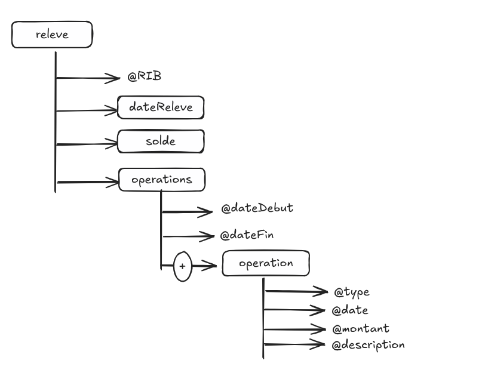
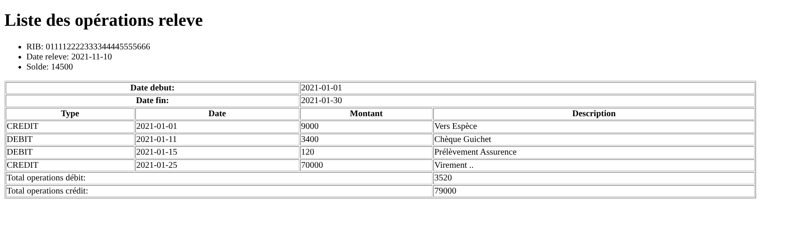
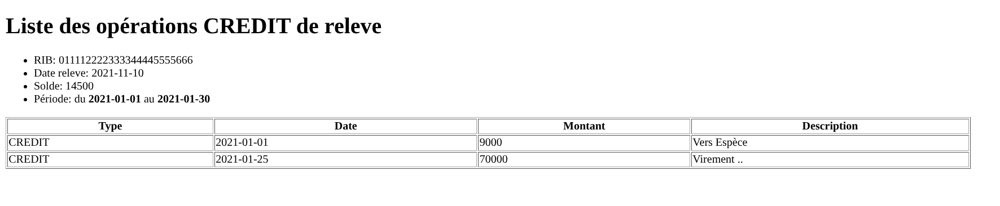

# DATA XML, DTD, XSD, XSL, SVG
## PARTIE 1: BIBLIO
### REPRESENTATION GRAPHIQUE

### REPRESENTATION HTML

## PARTIE 2: OPERATEUR
### REPRESENTATION GRAPHIQUE

### REPRESENTATION HTML

## PARTIE 3: RELEVE
### REPRESENTATION GRAPHIQUE

### REPRESENTATION HTML (Toutes les operations)

### REPRESENTATION HTML (Operations de type credit)

## PARTIE 4: METEO
### REPRESENTATION HTML

### REPRESENTATION SVG (ANNIMÉ)

